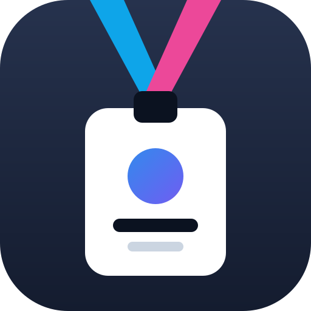

<p align="center"></p>

# WhichTalk

**Which talk are you going to?** WhichTalk is a fast, offline-friendly conference planner,
open source and open to new conferences: each one is a folder of settings and program data on
top of one shared app. Now live for NeurIPS 2026 (Sydney, Paris and Atlanta):
**[whichtalk.com/neurips/2026](https://whichtalk.com/neurips/2026/)**

**Add your conference:** see [CONTRIBUTING.md](CONTRIBUTING.md). Usually no code is needed.

No login, no server, no tracking: everything you save stays on your device.

> Unofficial. WhichTalk is not affiliated with or endorsed by any conference organizer,
> including the NeurIPS Foundation. Check each conference's official schedule.

## Features

- **Today**: what's next, your day as one list, free gaps filled with suggestions.
- **Search** across 9,000+ talks, papers, posters, people and rooms, instantly and on device.
- **Suggestions from your interests**: type them in, or import them from your OpenAlex or
  Semantic Scholar profile, your website, or pasted text.
- **Plan my day**: builds a draft day from your interests, with a pace setting, an optional
  lunch break and estimated walking time between rooms where the venue is mapped. Preview, apply, undo.
- **Clashes and alternatives**: overlapping items are flagged, with other times for the same content.
- **People**: who to meet and where to find them, who you met, notes and follow-ups.
- **Team mode**: import colleagues' share links to see who is going where, split up posters
  and find common free slots.
- **Reading list**: saved papers as BibTeX or a Markdown checklist, with a per-paper "read" mark.
- **What changed**: moved times and rooms for your saved items since your last visit.
- **Sync without a server**: move your plan between devices with a QR code, a link or a file.
  Calendar export (.ics), backups and automatic snapshots included.
- **Installable and offline**: works as a home-screen app and keeps working without a connection.

## Privacy

All state lives in your browser (IndexedDB and localStorage). Your plan is not sent anywhere
unless you start it: profile imports call OpenAlex, Semantic Scholar or the website you enter,
and each request is labelled with exactly what is sent where.

On whichtalk.com, each page view is counted with [GoatCounter](https://www.goatcounter.com):
the page's path and title, the referring page and the screen size, with no cookies and nothing
that identifies a visitor. The counter is skipped when the browser sends Do Not Track or Global
Privacy Control, and copies of WhichTalk hosted anywhere else never run it.

## Run it

Open `docs/neurips/2026/index.html` in a browser. It works straight from the file system.
Every conference is built the same way into its own folder.

The site is served by GitHub Pages from the `docs/` folder on `main`. To preview it locally
with the service worker (offline mode, install), serve that folder:

```sh
python3 -m http.server 8000 --directory docs   # then open http://localhost:8000/neurips/2026/
```

## Build

The `whichtalk` package builds each conference from its folder in `conferences/`. It needs
Python 3.9+ and the standard library only; the production build also runs `node --check` on the
bundled script.

```sh
python3 -I whichtalk list                          # the conferences, their source and output
python3 -I whichtalk check --all                   # validate every conference.json and events.json
python3 -I whichtalk build neurips-2026            # fetch the schedule, crawl new detail pages, build
python3 -I whichtalk build neurips-2026 --offline  # no network: build from conferences/neurips-2026/cache/
python3 -I whichtalk build example-2026            # the made-up demo conference, into _site/example/2026/
python3 -I whichtalk build --all                   # every conference, then the homepage
python3 -I whichtalk new yourconf-2027 --name "YourConf 2027"   # start a new conference folder
```

Other options: `--dev` (unbundled modules in `_dev/`), `--out DIR`, and for the neurips.cc
scraper `--no-crawl`, `--max-new N` and `--delay S`. `python3 -m whichtalk ...` works too.
Building a listed conference also regenerates the homepage, `docs/index.html`, from
`src/home.html` (or run `python3 -I whichtalk home`).

The neurips.cc scraper respects `robots.txt`, waits at least one second between requests and
caches what it fetches in `conferences/neurips-2026/cache/`, so later builds only request what is new.

## Tests

```sh
python3 -I -m unittest discover tests                # config, sources, build, homepage, bundler
python3 -m http.server 8000 --directory docs &       # then, with Node 24 and Google Chrome:
node tests/e2e.mjs --url http://localhost:8000/neurips/2026/
```

The end-to-end suite drives headless Chrome over the DevTools protocol with no dependencies.
Set `CHROME_PATH` if Chrome is not in `/Applications`. `--only name,name` runs some scenarios.

## Project layout

```
conferences/          one folder per conference: everything specific to it
  _template/          copied by `whichtalk new`; its README documents every field
  neurips-2026/       conference.json, cache/ (scraped pages), static/ (its own og.png)
  example-2026/       made-up demo: conference.json and events.json
src/                  the shared app, as ES modules
  main.js             entry point
  index.html          planner page template ({{placeholders}} and <!-- @styles/@catalog/@app -->)
  home.html           homepage template (<!-- @conferences --> is filled from the listed conferences)
  404.html            page for unknown addresses, built with the homepage (with robots.txt, sitemap.xml)
  lib/                DOM helpers, icons, time and text utilities
  data/               catalog decoding, conference settings, on-demand abstracts
  state/              store (prefs, data, ui), validation, IndexedDB and localStorage
  search/             search index and interest matching
  plan/               filters, clashes, starring, day planner, venue walking times, calendar, share links
  ui/                 shell, router, dialogs, detail panel, shared components
  views/              Today, Schedule, Rooms, Plan, People, Team, Reading, Sync, Settings ...
  styles/             main.css imports one file per area (tokens, rail, grid, print ...)
whichtalk/            the build: config checks, sources, catalog, JS bundler, site and homepage writers
  sources/            where programs come from: events_file.py, neurips_cc/ (scraper)
tests/                unit tests (Python) and end-to-end tests (Node + Chrome)
vendor/qrcode.js      QR code generator (MIT, Kazuhiko Arase)
static/               service worker, manifest, icons, fonts, og.png: copied next to every page
docs/                 the published site (whichtalk.com)
  index.html          homepage
  neurips/2026/       the built planner: index.html, abstracts/ (loaded on demand), static files
```

## License

Copyright (C) 2026 Jacopo Gargano.

The code is released under the [GNU Affero General Public License v3.0](LICENSE)
(AGPL-3.0-only). You may use, change and share it, commercially too, but anyone who shares a
changed copy, or runs one for other people over a network, must make its full source available
under the same license.

The WhichTalk name and logo are not covered by the license.

The pages use the [Geist](https://github.com/vercel/geist-font) typeface by Vercel, self-hosted
(`static/geist-*.woff2`), under the [SIL Open Font License 1.1](LICENSE-GEIST.txt).

Program data belongs to each conference's organizers and authors and is not covered by the
code's license. For NeurIPS 2026, the schedule, abstracts and descriptions in `docs/neurips/` and
`conferences/neurips-2026/cache/` come from [neurips.cc](https://neurips.cc). The program of
`conferences/example-2026/` is made up.
